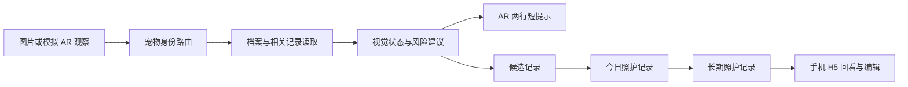

# 系统架构与能力边界

## 产品分工

AR 显示端用于当下短提示。手机 H5 用于宠物切换、档案编辑、照护记录和设置。统一后端承接身份路由、记忆检索、视觉状态推理、AR 文本压缩及记录写回。

当前本地 demo 使用 JSON 文件存储。候选记录、今日记录和长期记录在代码中分层；候选不等于已确认的宠物习惯。

## 已有实现

- `backend/server.mjs` 提供 `/health`、`/api/mobile/bootstrap`、`/api/ar/analyze`、`/api/ar/display/latest`、宠物档案与照护记录接口。
- `mobile-web/` 连接后端，展示多宠档案、照护时间线和纪念档案。
- `android-ar/` 包含模拟器中使用过的双目显示源码；后端地址为空时可使用模拟状态。厂商 SDK 不在仓库中。
- 后端在未配置云端模型时可降级到 mock 规则，便于演示 UI 与接口；mock 不证明 AI 质量。

## 需要继续验证

| 能力 | 当前状态 |
| --- | --- |
| RayNeo 真机采集、佩戴可读性、延迟 | 未实机验收 |
| 声音识别和宠物端双向反馈 | 未接入正式链路 |
| PetFace 视觉个体识别 | 预留 adapter；无真实权重时使用占位路由 |
| 独立猫犬行为识别模型 | 因缺少适用权重，从正式链路删除 |
| 复杂长期记忆推理 | 有存取结构，未做正式专项评测 |
| 真实用户试用 | 下一阶段 |

## 关于在线演示

`docs/` 是可放在 GitHub Pages 的静态样例回放。它使用提前写好的展示文案，与 `backend/` 的云端视觉推理调用分开。页面明确标记“样例回放”，不表示实时 AI 或真实眼镜输出。
