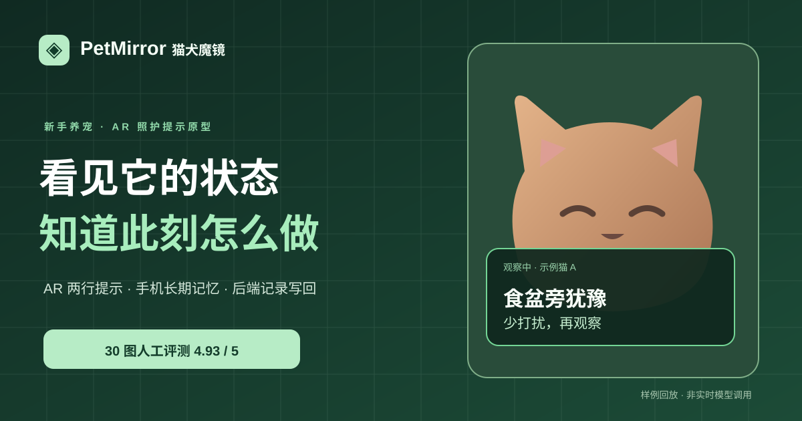

# 猫犬魔镜 · PetMirror AR

**给新手养宠者的第一视角照护提示原型。** AR 端显示短状态与行动建议；手机 H5 保存宠物档案和照护记录；本地 Node.js 后端连接提示与记忆写回。

> 南京大学 2026 OpenClaw 应用创新大赛二等奖项目。比赛平台在开发期间无法正常执行指令，经主办方允许后，原型主要借助其他 AI Agent 工具在本地完成。此仓库不依赖 OpenClaw 运行时。

**[项目展示首页](https://ymg-glitch.github.io/petmirror-ar/)** · **[手机 H5 演示](https://ymg-glitch.github.io/petmirror-ar/mobile/)** · **[AR 眼镜端模拟](https://ymg-glitch.github.io/petmirror-ar/ar/)** · [架构](./ARCHITECTURE.md) · [评测](./EVALUATION.md)

现场展示可参考[本地投屏说明](./LOCAL_DEMO.md)，Windows 可使用 `start-local-demo.cmd` 启动后端与 H5。



在线页是静态交互展示，**不调用摄像头、麦克风或在线 AI**。本地后端可运行；未配置云端模型时会使用明确标记的 mock 推理。

[手机 H5 在线版](https://ymg-glitch.github.io/petmirror-ar/mobile/)复用实际 H5 页面代码，使用虚构数据；切换和编辑只保留在当前浏览器会话，刷新即重置。需要持久化和后端接口时请按下文在本地运行。

[AR 眼镜端在线版](https://ymg-glitch.github.io/petmirror-ar/ar/)按 Android 显示设计重现双目、低遮挡、两行提示，并提供场景切换；它是浏览器回放，不是真实眼镜画面。

仓库中的宠物名称、体重、行为、纪念档案和照护记录均为**虚构演示数据**，不对应真实宠物或主人。在线页另用简化样例回放展示交互。

## 一眼看懂项目

| 部分 | 当前实现 |
| --- | --- |
| AR Android | 基于 MercurySDK 的双目低遮挡提示界面，曾在 Android 模拟器中显示。仓库不含厂商 SDK。 |
| 手机 H5 | 多宠切换、档案、照护时间线、设置及纪念档案。 |
| 统一后端 | 身份路由、档案与记录读取、视觉状态推理入口、两行提示、候选池到每日及长期记录。 |
| AI 评测 | 30 张静态猫犬图片、17 项指标、单人 1–5 分评分；综合均分 4.93/5。 |

真实 RayNeo 采集、声音识别、PetFace 视觉个体识别、宠物端双向反馈和复杂长期记忆调用没有纳入这轮评测。4.93/5 是小样本人工评分，**不是现实场景准确率**。详见[评测说明](./EVALUATION.md)。

## 本地运行

需要 Node.js。后端采用原生 HTTP 服务，无需先安装 npm 依赖。

```powershell
cd backend
node server.mjs
```

另开终端：

```powershell
cd mobile-web
node serve.mjs
```

浏览器打开 `http://127.0.0.1:8792`。后端默认在 `http://127.0.0.1:8791`。可检查：

```text
GET /health
GET /api/mobile/bootstrap
GET /api/ar/display/latest
GET /api/identity/status
GET /api/llm/status
```

无 API key 时，后端可能使用 mock 规则输出供界面联调。若要运行云端视觉模型，请按[后端配置说明](./backend/README.md)设置自己的密钥；不要把密钥提交到仓库。`android-ar/` 需另行获取具备使用权的 MercurySDK AAR，详见[AR 说明](./android-ar/README.md)。

发布包的本地只读接口检查：

```powershell
node scripts/smoke.mjs
```

## 仓库结构

```text
docs/          GitHub Pages 静态样例回放
mobile-web/    实际手机 H5 源码
backend/       实际统一后端与演示数据
android-ar/    AR Android 源码（不含厂商 SDK）
ARCHITECTURE.md
EVALUATION.md
evaluation/     不含原图的逐项评分与汇总
LICENSE
```

## 为什么这样设计

- **AR 端只显示两行。** 面对宠物时，用户需要看得见、读得快的提醒。
- **手机端管理长期信息。** 档案、照护记录和纪念档案更适合回看与编辑。
- **候选记录先筛再固化。** 单次 AI 观察不会直接变成长期事实。
- **保留失败案例。** 早期四分类情绪模型误判；正式 30 图评测也保留了一条中文短句 Bad Case。

系统各层、数据流与能力边界见[架构说明](./ARCHITECTURE.md)。

## 公开范围

仓库只授权本仓库的原创代码与文档。厂商 MercurySDK AAR、开源模型权重、第三方宠物照片、比赛团队 PPT 和完整原始评测图片不随仓库发布。静态页的动物图形是仓库内 SVG 代码绘制的示意，不属于正式评测样例。原评测照片来源为 Flickr/LoremFlickr 或 PxHere 候选图，公开使用需逐张确认授权。

## 许可

本仓库原创代码与文档使用 [MIT License](./LICENSE)。第三方组件和素材遵循各自许可，不包含在该授权中。

